<!-- ✨ SANKALPA SITHMINA — GITHUB PROFILE README ✨ -->
<!-- Repository: https://github.com/sana1211/sana1211 -->

  

   

  

  

    
    
    
    
  

  
  

---

## 🧑‍💻 &nbsp; About Me

> **“Code with purpose. Design with creativity. Build with passion.”**

I'm **Sankalpa Sithmina**, a **Bachelor of Information Technology (BIT) undergraduate at the University of Moratuwa, Sri Lanka** 🇱🇰, passionate about creating clean, responsive web experiences and exploring the possibilities of software and hardware.

- 🎨 **Frontend & UI/UX:** Building responsive interfaces with **React, Next.js, JavaScript, TypeScript, HTML, CSS and Tailwind CSS**; designing and prototyping in **Figma**.
- ⚙️ **Backend & Databases:** Exploring **Node.js, .NET, Java, PHP, MongoDB and SQL**.
- 🤖 **Robotics & IoT:** Learning through hands-on experiments with **Arduino** and connected devices.
- 📚 **Currently growing:** My skills in modern web development, backend technologies and real-world engineering.
- 🎯 **Career goal:** Open to **junior frontend development opportunities**, collaboration and exciting projects.
- 💬 **Ask me about:** Web development, interface design and making ideas come to life.

  

---

## 🛠️ &nbsp; My Tech Universe

  <h4>🌐 Frontend Development</h4>
  

  <h4>⚙️ Backend & Programming</h4>
  

  <h4>🗄️ Databases</h4>
  

  <h4>🧰 Design, Hardware & Developer Tools</h4>
  

---

## 📈 &nbsp; GitHub Insights

  
  
   
  

  

---

## 🐍 &nbsp; My Contributions in Motion

  <picture>
    <source media="(prefers-color-scheme: dark)" srcset="https://raw.githubusercontent.com/sana1211/sana1211/output/github-contribution-grid-snake-dark.svg" />
    <source media="(prefers-color-scheme: light)" srcset="https://raw.githubusercontent.com/sana1211/sana1211/output/github-contribution-grid-snake.svg" />
    
  </picture>

<!-- Snake animation appears after you run the included .github/workflows/snake.yml action once. -->

---

## 🚀 &nbsp; Featured Work

  
  
  

---

## 🏅 &nbsp; Learning Milestones & Achievements

| 🎓 Certificate / Qualification | 🏛️ Institution | 🏆 Result |
| :--- | :--- | :---: |
| Python for Beginners | University of Moratuwa | **Grade A** |
| Web Design for Beginners | University of Moratuwa | **Grade A** |
| Fundamentals of Digital Marketing | Google Digital Garage | **Completed** |
| Diploma in MS Office | — | **Grade C** |

---

## 🤝 &nbsp; Let's Build Something Together

  <h3>Have a project, an idea or an opportunity?</h3>
  
I'm always interested in learning, creating and connecting with other developers.

  
  &nbsp;
  
    
  Made with 💙 by <a href="https://github.com/sana1211"><b>Sankalpa Sithmina</b></a> • Sri Lanka 🇱🇰
   

